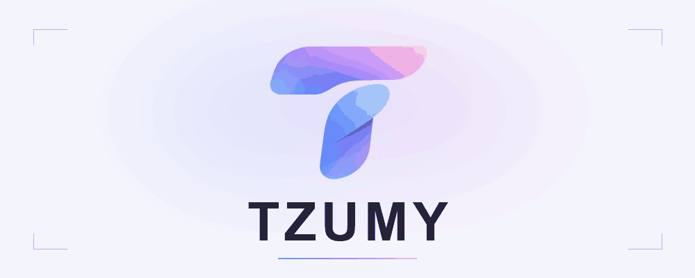

  <picture>
    <source media="(prefers-reduced-motion: reduce) and (prefers-color-scheme: dark)" srcset="./assets/tzumy-hero-dark.png">
    <source media="(prefers-reduced-motion: reduce)" srcset="./assets/tzumy-hero-light.png">
    <source media="(prefers-color-scheme: dark)" srcset="./assets/tzumy-hero-dark.gif">
    <source media="(prefers-color-scheme: light)" srcset="./assets/tzumy-hero-light.gif">
    
  </picture>

<h1 align="center">Innovación, tecnología y talento para construir el futuro</h1>

  Software, inteligencia artificial y nuevas posibilidades. 
  Construimos con criterio. Innovamos para crear valor.

  

## Quiénes somos

**TZUMY es una organización tecnológica en crecimiento**, con la visión de transformar ideas en soluciones digitales útiles, escalables y de calidad.

Nos mueve una pregunta: ¿cómo puede la tecnología resolver mejor un problema real? Desde esa perspectiva, buscamos desarrollar productos digitales que conecten ingeniería, inteligencia artificial y una experiencia de uso cuidada.

Nuestro enfoque combina curiosidad para explorar, criterio para elegir y disciplina para construir. Queremos crecer sobre una base sólida: aprender de cada desafío y crear tecnología que pueda evolucionar con las personas que la utilizan.

## Qué hacemos

Estas áreas orientan nuestro trabajo y las soluciones que buscamos desarrollar:

- **Ingeniería de software** — Sistemas mantenibles, código claro y decisiones técnicas que resistan el paso del tiempo.
- **Inteligencia artificial y machine learning** — Exploración y desarrollo de soluciones que apliquen modelos a problemas concretos, con evaluación de sus resultados y límites.
- **Ciencia de datos y analítica** — Datos que ayuden a comprender contextos, descubrir patrones y tomar decisiones informadas.
- **Desarrollo web y mobile** — Experiencias digitales accesibles y coherentes, pensadas para las personas y su contexto de uso.
- **Automatización e integraciones** — Conexión de herramientas y procesos para reducir tareas repetitivas y simplificar operaciones.
- **Cloud computing y arquitectura de software** — Diseño de soluciones preparadas para crecer, con atención a la fiabilidad, la seguridad y el uso de recursos.

## Nuestra filosofía

La forma de construir importa tanto como el resultado.

- **Innovación continua.** Explorar posibilidades, validar ideas y adoptar lo que aporta valor.
- **Aprendizaje constante.** Investigar, experimentar y convertir lo aprendido en mejores decisiones.
- **Calidad de ingeniería.** Cuidar el diseño, las pruebas, la documentación y el mantenimiento desde el inicio.
- **Colaboración.** Compartir conocimiento y reunir distintas perspectivas para resolver mejor.
- **Escalabilidad.** Diseñar para evolucionar, sin añadir complejidad antes de necesitarla.
- **Tecnología con propósito.** Partir de una necesidad real y evaluar las soluciones por su utilidad.

  

  <strong>TZUMY</strong> 
  El futuro se construye. Hagámoslo con propósito.

